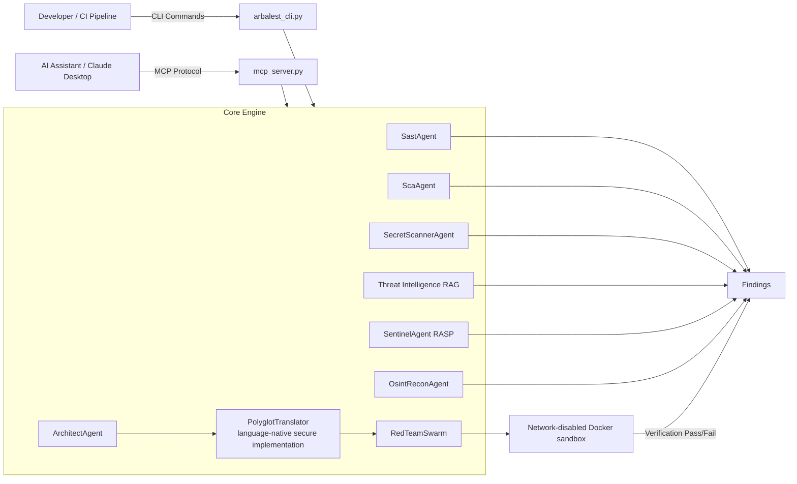

# Architecture

This guide describes the current code paths of the Arbalest Headless CLI and MCP Server.

## Runtime topology

## CLI execution

The `arbalest_cli.py` acts as the primary orchestrator for CI/CD environments. 
When `arbalest scan` is executed, the tool performs a bounded local directory traversal (skipping massive directories like `node_modules` or `.git`) and submits the codebase to the configured AI provider.

The CLI supports exporting results in standard formats (`--format sarif`) for ingestion into GitHub Advanced Security, or stylized HTML (`--format html`) for executive compliance reporting (mapping to SOC2/ISO27001).

## MCP Server

The `mcp_server.py` implements the Model Context Protocol over standard `stdio`. It exposes tools directly to the host AI client (e.g., Cursor, Claude). The tools exposed map 1:1 with the CLI capabilities:
- `scan_repository`
- `scan_code_snippet`
- `fix_vulnerability`
- `verify_fix`

## Orchestrator stages

The engine executes in discrete stages depending on the tool invoked:

1. **Live Traffic Interception & OSINT Recon**: The `SentinelAgent` hooks into live traffic and intercepts malicious payloads, yielding them to the loop. The `OsintReconAgent` maps the external attack surface of the target.
2. **Threat Discovery**: `SastAgent`, `ScaAgent`, and `SecretScannerAgent` parse source code files for logic flaws, CVEs, and credentials.
3. **Mutation planning and translation**: `ArchitectAgent` creates a secure mutation plan to resolve a specific vulnerability. `PolyglotTranslator` executes the plan into language-specific code blocks.
4. **Red-team sandbox verification**: `RedTeamSwarm` requests a Bash-only local harness. The generated code is mounted into a resource-bounded, network-isolated Docker sandbox. A reproduced exploit forces a failure, while surviving the exploit yields a `[SAFE]` classification.

## Data and lifecycle boundaries

- Provider configuration and run coordination are entirely in process memory. No data is sent to a central proprietary backend; your code is only sent to the AI Provider you explicitly configure.
- Sandbox source is materialized in a separate temporary host directory, mounted read-only, copied to container tmpfs for builds, then removed in the manager's cleanup path.
- The Red Team sandbox explicitly disables outbound networking (`network_mode="none"`) to prevent AI-hallucinated packages from being downloaded or executed during verification.
