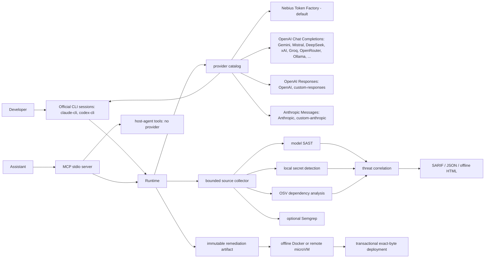
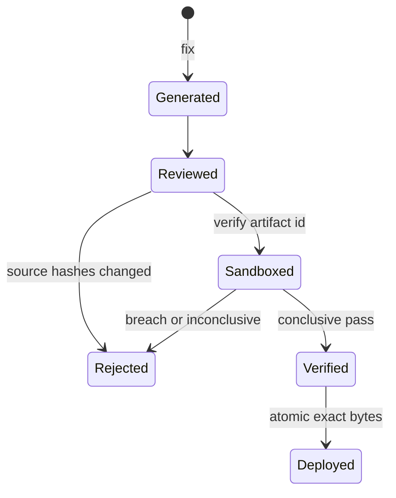

# Arbalest architecture

This document describes the user-reachable CLI and MCP paths. Modules not connected to either entry point are explicitly marked experimental.

## Runtime topology

## Provider boundary

`engine/services/provider_catalog.py` declares every provider once: id, wire protocol, default endpoint, key variables, and whether a key or base URL is required. Runtime, CLI choices, and MCP enums derive from it. Agents only see `AIProvider`, so adding a provider never touches agent code.

- **Protocols:** `openai_chat` (portable Chat Completions), `openai_responses` (strict JSON schema), `anthropic` (forced schema tool, `tool_use`/`tool_result`), `local_cli` (official authenticated executable).
- **Default:** `nebius`, Token Factory Chat Completions with the Nemotron Ultra fallback. Its behavior is unchanged.
- **Presets:** OpenAI, Anthropic, Google Gemini, Mistral, DeepSeek, xAI, Groq, Together, Fireworks, Cerebras, OpenRouter, Vercel AI Gateway, Ollama, LM Studio, plus `custom`, `custom-responses`, and `custom-anthropic`.
- **Operator endpoints:** `arbalest.providers.json` (or `ARBALEST_PROVIDERS_FILE`) adds named endpoints. Files may not contain credentials or shadow built-in ids; id `my-gateway` reads `MY_GATEWAY_API_KEY`.
- **Subscriptions:** `claude-cli` and `codex-cli` run the official CLI with stdin input, an empty temporary working directory, native tools and MCP disabled, no persisted session, bounded output, and process-tree cleanup on timeout or cancellation. Token files are never read. Tool loops use an Arbalest-validated JSON turn envelope bounded to 64 calls.
- **Host-agent MCP:** the MCP host's own model authors plans, bundles, and optional harnesses. Arbalest re-derives the grounded context, rejects stale digests, validates against the repository, seals the artifact, and computes the sandbox verdict itself.

Credentials resolve only from each provider's own variables, with no cross-vendor fallback. MCP arguments never carry keys. An MCP host login never flows to Arbalest automatically; subscription use happens only when the operator selects a `*-cli` provider or the host-agent tools.

The verification sandbox is independent of the model provider: Nebius Sandboxes when `NEBIUS_PROJECT_ID` is set, otherwise local Docker.

## Trust boundaries

1. **Repository input:** collection accepts only regular files whose resolved paths remain under the target. File count, per-file size and aggregate bytes are bounded. Coverage omissions mark the scan incomplete.
2. **Model input:** source documents are secret-redacted, stripped of invisible injection characters and wrapped in nonce-delimited data fences. Secret detection itself is local and deterministic.
3. **Dependency intelligence:** exact pinned direct dependencies are queried against OSV. A failed advisory lookup is an incomplete specialist result, never an inferred clean bill of health.
4. **Generated code:** Pydantic contracts validate plans, bundles and paths. Fix generation creates a content-addressed artifact containing source hashes and the exact generated bytes.
5. **Execution:** generated code runs through `SandboxBackend`. Docker uses argv execution, a read-only root, non-root identity, no network, dropped capabilities and resource/output bounds. Remote sandbox behavior must pass `arbalest sandbox-check` before use.
6. **Deployment:** verification loads an existing artifact, rejects stale source hashes and tests the exact bundle. Verification is read-only by default. CLI deployment requires `--apply`, strong adversarial evidence and atomic replacement with rollback. Signature-only or low-confidence results can produce a review artifact but cannot write source. MCP verification never deploys.
7. **Git:** fleet commits are created in isolated temporary worktrees from exact verified content. Operator branches, staged files and working-tree changes are not included.
8. **Scan archives:** canonical findings, coverage and receipts are hashed into an atomic seal bound to provider/model and repository revision. History and comparison load only verified archives.

## Scan state model

`SwarmResult` carries findings, per-agent status, source coverage and an explicit `complete` property. Required-specialist or collection failure has these effects:

- CLI exit code `2`;
- JSON `status: incomplete` and `complete: false`;
- SARIF `executionSuccessful: false` plus tool notifications;
- MCP tool error after the incomplete SARIF diagnostic is written.

Partial findings remain available for diagnosis but are not a clean verdict.

## Remediation lifecycle

The artifact ID is derived from canonical finding, plan, bundle and source-hash data. Verification never regenerates the candidate.

Git-diff scans resolve the requested base to an immutable commit, capture the current HEAD, include supported changed and untracked files, and record deleted/renamed paths in coverage. A rejected revision or non-root worktree fails before provider analysis.

## MCP surface

The stdio server exposes ten bounded tools from a single registry:

- Provider-backed: `scan_repository`, `scan_code_snippet`, `fix_vulnerability`, `verify_fix`
- Local: `query_threat_intel`, `list_scan_history`, `compare_scan_runs`
- Host-agent (no provider): `prepare_remediation_context`, `submit_remediation_candidate`, `verify_remediation_candidate`

Set `ARBALEST_MCP_ALLOWED_ROOTS` for every deployment. Without it, MCP
filesystem access is denied. A deliberately named unsafe escape hatch exists
only for isolated local compatibility and must not be enabled in shared or
production processes. Framed messages are capped at 8 MiB with bounded headers;
oversized frames are discarded without desynchronizing the stream. Remediation
artifacts are write-once: an existing artifact path is returned only when its
hash matches, and is never overwritten.

## Advanced modes

- **Immune:** deterministic detection/topology plus sandboxed minimax remediation and validated antibody learning.
- **Fleet:** federated topology, bounded concurrent sandbox verification, validated antibody broadcast and isolated-worktree GitOps.
- **Ouroboros:** governed self-modification with mirror verification. Treat this as an experimental operator feature; it is not part of the normal scan/fix path.
- **Experimental modules:** the composable master loop and standalone Sentinel path are research components until connected through a supported entry point. They must not be represented as part of a normal `scan` run.

## Data lifecycle

- Source is sent only to the explicitly configured model provider after local secret redaction and fencing.
- OSV receives package ecosystem, name and exact version—not source code.
- Tavily is optional and receives bounded vulnerability-intelligence queries, not repository source.
- Workspace memory uses a local SQLite database under `.arbalest/memory` by default and excludes secret findings.
- Sandbox temporary directories and containers are cleaned on completion, timeout and cancellation.
